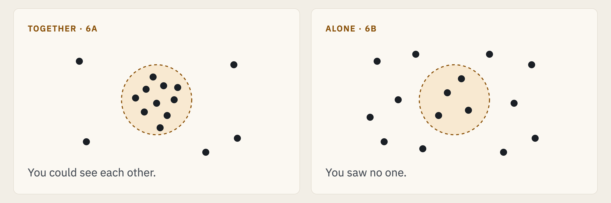
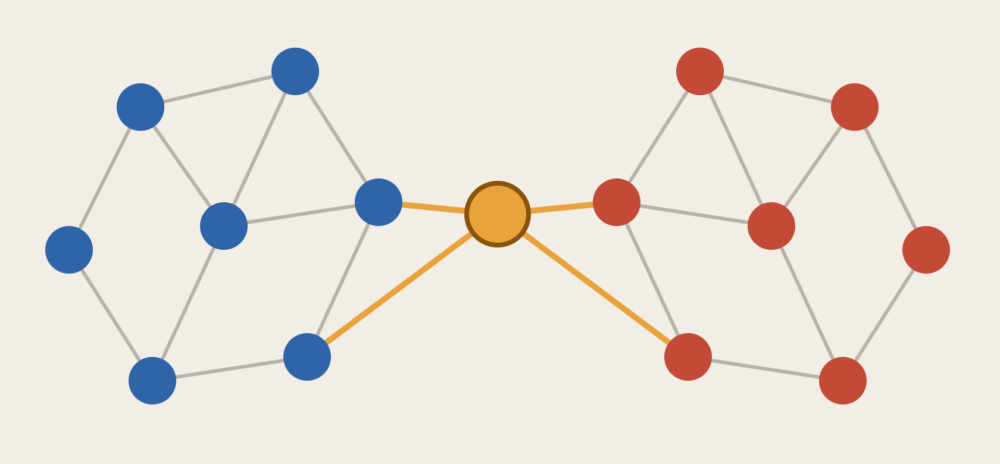
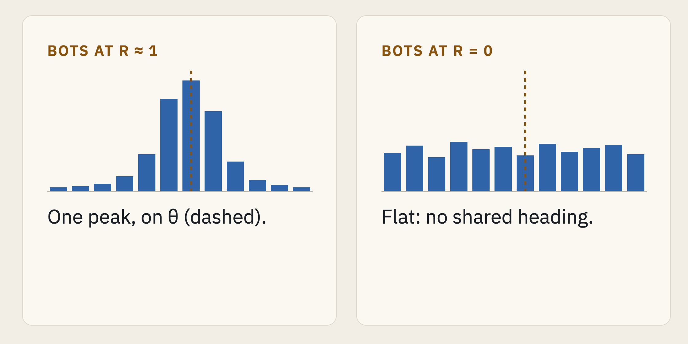
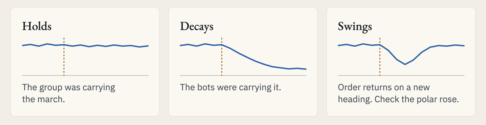
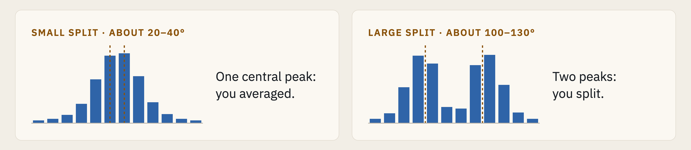
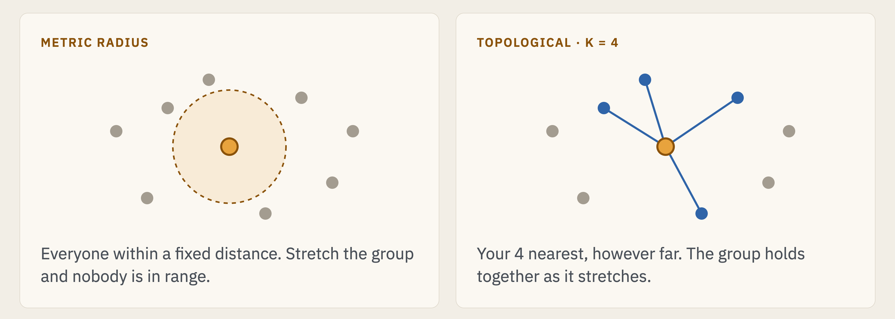
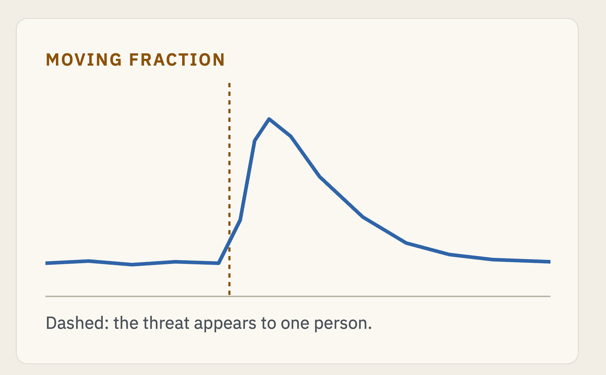

# You are the flock

Each of you is one animal in a shared field. You see only the neighbours the experiment allows. The pattern is measured afterwards.

Fifteen students share that field. On screen, the animal is a fox. Two comparisons follow: a search for a patch nobody was shown, and two chambers linked by one bridge. On the [live page](https://pvnkmrksk.github.io/classroom-agents/) you scroll through the paths. The stills are here.

## In the herd

[](examples/videos/fpv-herd.mp4)

First person, sixteen seconds. The foxes face the way they are travelling. Scarves are off in this clip. [Open the video](examples/videos/fpv-herd.mp4).

## A patch nobody was shown

[](examples/videos/taxis-side-by-side.mp4)

When the animals can see each other, the search finishes. When each animal sees no one, it is still unfinished. [Open the video](examples/videos/taxis-side-by-side.mp4). Scrolling the [live page](https://pvnkmrksk.github.io/classroom-agents/#patch) moves through these paths.


The curve counts how many have reached the patch. Together, half the group is in by 34 seconds and all 13 are inside by 44. Alone, half have arrived by 47 seconds, and at 122 seconds the count is 10 of 13.



The picture the model leads you to expect. Together, the group gathers in the patch. Alone, most of them stay outside it. After [Berdahl et al., 2013](https://doi.org/10.1126/science.1225883).

## Who could see whom



Blue sees only blue. Red sees only red. Gold is the one bridge that sees both.

## Echo chambers

[](examples/videos/echo-side-by-side.mp4)

With a bridge, the chambers settle on one heading and order rises from about 0.3 to 1. Without a bridge, order stays low, near 0.2. [Open the video](examples/videos/echo-side-by-side.mp4). Scrolling the [live page](https://pvnkmrksk.github.io/classroom-agents/#echo) moves through these paths.


Φ is the order: 0 when headings are random, 1 when everyone moves the same way.

## The room


The lecturer’s view of the march. One cell is drawn here. On a student’s screen the same foxes continue into the fog, so the field has no edge.


The hidden patch, from the lecturer’s screen and from a student’s. Students are not told where it is. The blue rim is a hint the lecturer can turn off.

## The other patterns



A locked march has one peak, on the swarm’s heading. A meandering swarm is flat. R is the bots’ own order: near 1 they hold a heading, at 0 they wander. After [Vicsek et al., 1995](https://doi.org/10.1103/PhysRevLett.75.1226) and [Buhl et al., 2006](https://doi.org/10.1126/science.1125142).



The dashed line is the moment the bots vanish. Order may hold, fall away, or return on a new heading. After [Buhl et al., 2006](https://doi.org/10.1126/science.1125142).



A small angle is averaged into one peak. A large angle stays two. After [Couzin et al., 2005](https://doi.org/10.1038/nature03236).



A fixed radius empties out when the group stretches. The four nearest still hold the group together. After [Ballerini et al., 2008](https://doi.org/10.1073/pnas.0711437105).



The dashed line is the moment one person sees the threat. Movement spikes, then settles.

## What the class runs

Each button on the teacher’s screen starts that experiment.

| | The point | Source |
|---|---|---|
| 1A Entrainment | Follow a marching swarm. | [Vicsek et al., 1995](https://doi.org/10.1103/PhysRevLett.75.1226); [Buhl et al., 2006](https://doi.org/10.1126/science.1125142) |
| 1B Handoff | The swarm vanishes. Does the march hold? | [Buhl et al., 2006](https://doi.org/10.1126/science.1125142) |
| 2 Bifurcation | Two streams. A small angle is averaged. A large angle stays two headings. | [Couzin et al., 2005](https://doi.org/10.1038/nature03236) |
| 3 Informed | Three of the fifteen privately see a beacon. The rest are not told the direction. | [Couzin et al., 2005](https://doi.org/10.1038/nature03236) |
| 4A Echo chambers | Blue sees blue, red sees red. One bridge sees both. | The classroom network |
| 4B Neighbours | The k nearest, however far, or only those inside a fixed radius. | [Ballerini et al., 2008](https://doi.org/10.1073/pnas.0711437105) |
| 5 Looming | One student sees the threat. The others see a neighbour bolt. | A looming stimulus, in the locust collision-detector tradition |
| 6 Patch | A hidden patch slows you down. Together you can see each other. Alone you see no one. | [Berdahl et al., 2013](https://doi.org/10.1126/science.1225883) |
| 7 Stop and go | An automatic pause just before a bump. | [Ariel et al., 2014](https://doi.org/10.1371/journal.pone.0101636); [Bazazi et al., 2008](https://doi.org/10.1016/j.cub.2008.04.035) |
| 8 Avoid bumps | Contact costs. Order can come from not hitting each other. | [Bazazi et al., 2008](https://doi.org/10.1016/j.cub.2008.04.035); [Romanczuk et al., 2009](https://doi.org/10.1103/PhysRevLett.102.010602) |

## Run the class

Needs Node.js 20 or newer.

```bash
git clone https://github.com/pvnkmrksk/classroom-agents.git
cd classroom-agents
npm install
npm start
```

Students open [http://localhost:3000](http://localhost:3000) and join with `matrex`. The teacher opens [http://localhost:3000/admin](http://localhost:3000/admin) with `matrexvr`.

A live class needs this server on a machine the students can reach. The site only plays the saved examples.

Click to look around. WASD or the arrow keys move.

## References

- Vicsek, T., Czirók, A., Ben-Jacob, E., Cohen, I. and Shochet, O. Novel type of phase transition in a system of self-driven particles. *Physical Review Letters* 75, 1226 (1995). [doi:10.1103/PhysRevLett.75.1226](https://doi.org/10.1103/PhysRevLett.75.1226)
- Buhl, J., Sumpter, D. J. T., Couzin, I. D., Hale, J. J., Despland, E., Miller, E. R. and Simpson, S. J. From disorder to order in marching locusts. *Science* 312, 1402–1406 (2006). [doi:10.1126/science.1125142](https://doi.org/10.1126/science.1125142)
- Couzin, I. D., Krause, J., Franks, N. R. and Levin, S. A. Effective leadership and decision-making in animal groups on the move. *Nature* 433, 513–516 (2005). [doi:10.1038/nature03236](https://doi.org/10.1038/nature03236)
- Ballerini, M., Cabibbo, N., Candelier, R., Cavagna, A., Cisbani, E., Giardina, I., Lecomte, V., Orlandi, A., Parisi, G., Procaccini, A., Viale, M. and Zdravkovic, V. Interaction ruling animal collective behavior depends on topological rather than metric distance. *PNAS* 105, 1232–1237 (2008). [doi:10.1073/pnas.0711437105](https://doi.org/10.1073/pnas.0711437105)
- Berdahl, A., Torney, C. J., Ioannou, C. C., Faria, J. J. and Couzin, I. D. Emergent sensing of complex environments by mobile animal groups. *Science* 339, 574–576 (2013). [doi:10.1126/science.1225883](https://doi.org/10.1126/science.1225883)
- Ariel, G., Ophir, Y., Levi, S., Ben-Jacob, E. and Ayali, A. Individual pause-and-go motion is instrumental to the formation and maintenance of swarms of marching locust nymphs. *PLOS ONE* 9, e101636 (2014). [doi:10.1371/journal.pone.0101636](https://doi.org/10.1371/journal.pone.0101636)
- Bazazi, S., Buhl, J., Hale, J. J., Anstey, M. L., Sword, G. A., Simpson, S. J. and Couzin, I. D. Collective motion and cannibalism in locust migratory bands. *Current Biology* 18, 735–739 (2008). [doi:10.1016/j.cub.2008.04.035](https://doi.org/10.1016/j.cub.2008.04.035)
- Romanczuk, P., Couzin, I. D. and Schimansky-Geier, L. Collective motion due to individual escape and pursuit response. *Physical Review Letters* 102, 010602 (2009). [doi:10.1103/PhysRevLett.102.010602](https://doi.org/10.1103/PhysRevLett.102.010602)
